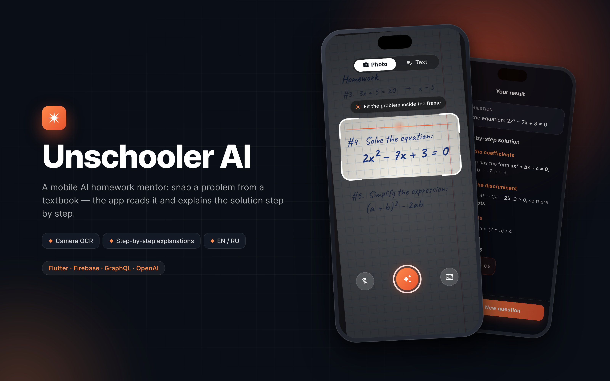
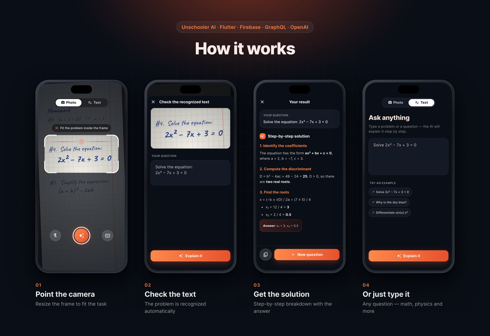

# Unschooler AI

A mobile AI homework mentor built with Flutter. Point the camera at a problem from a textbook — the app crops it, recognizes the text and returns a step-by-step explanation.




## Features

- Camera scanner with a resizable crop frame, server-side OCR of the cropped area
- Editable recognized text before sending, or plain text input with example prompts
- Step-by-step answers rendered as Markdown
- Google sign-in via Firebase Auth, GraphQL backend (OpenAI completions)
- English and Russian localization

## Demo mode

The original backend (`back.unschooler.me`) is no longer online, so the app runs in demo mode by default: OCR and AI answers come from canned data, sign-in is skipped, and when no camera is available (e.g. iOS Simulator) a rendered notebook page is shown instead of the camera feed.

```sh
flutter run                               # demo mode
flutter run --dart-define=DEMO_MODE=false # real backend
```

For screenshots, a `demo.json` in the app's Documents folder can open a specific screen and language:

```json
{ "screen": "home", "locale": "en" }
```

`screen` is one of `auth`, `home`, `text`, `scan`, `result`.

Russian versions of the images and raw simulator screenshots are in [screenshots/](screenshots/).
